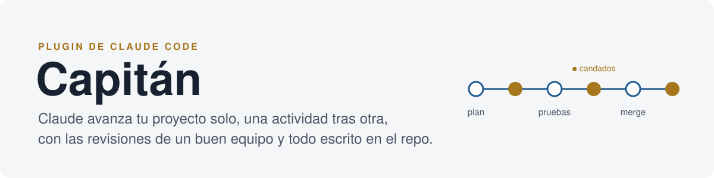
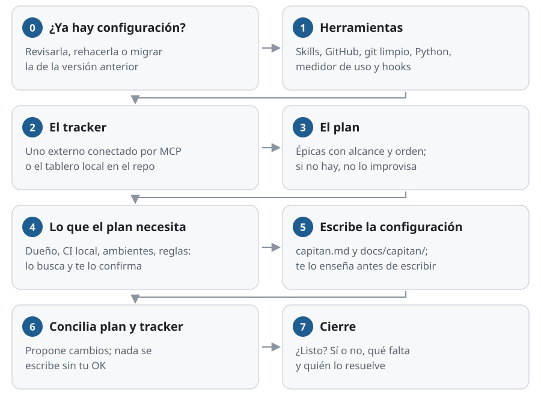
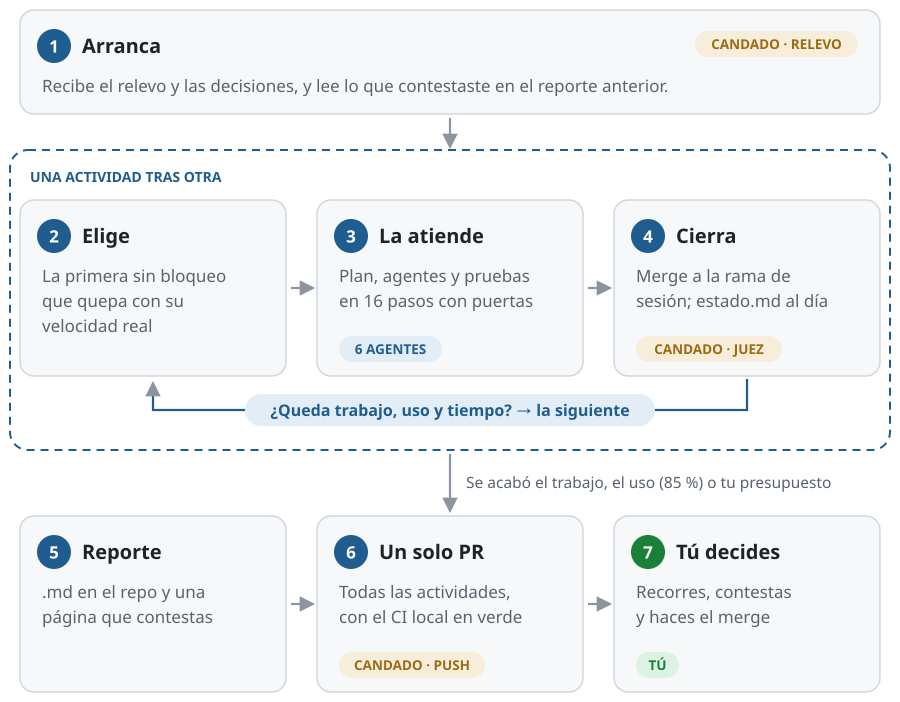
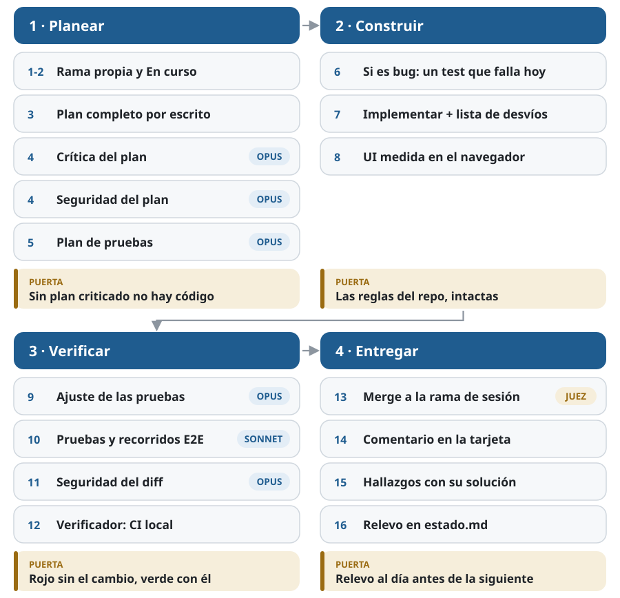
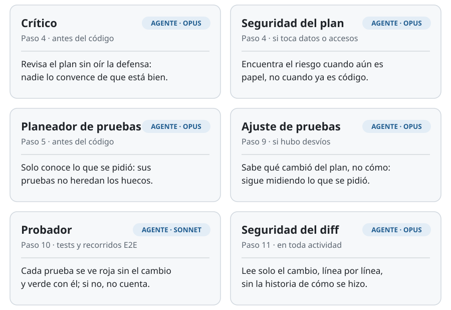
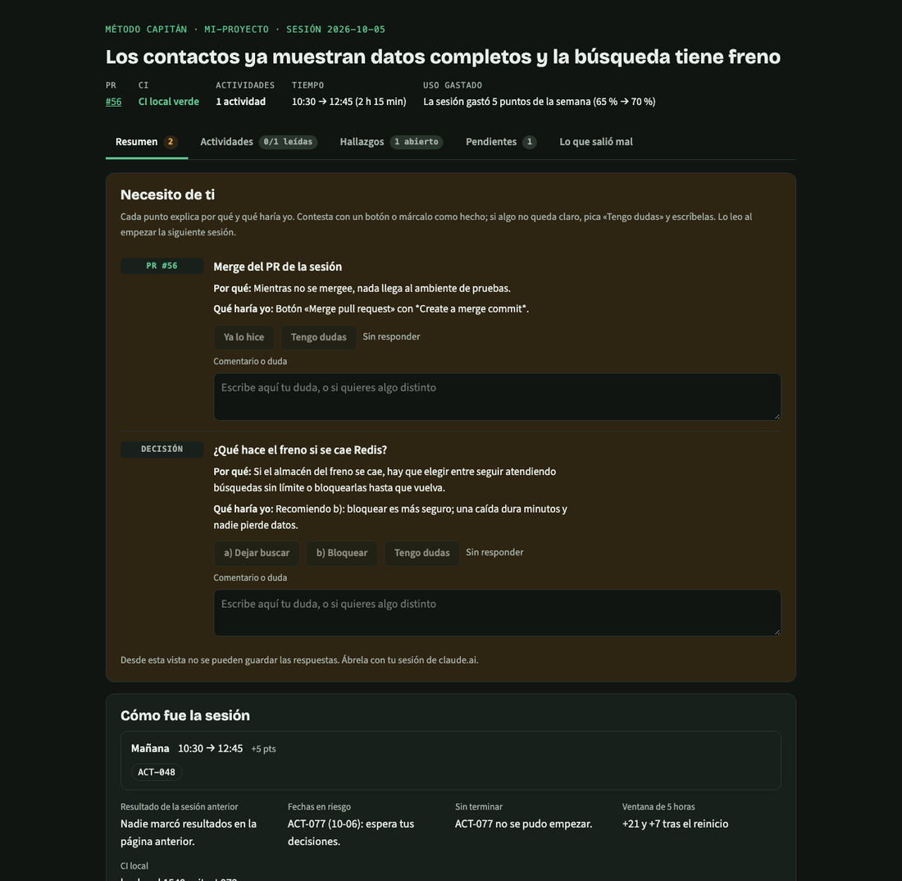
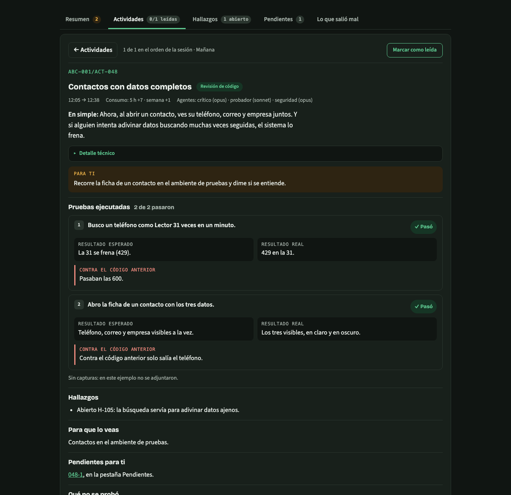
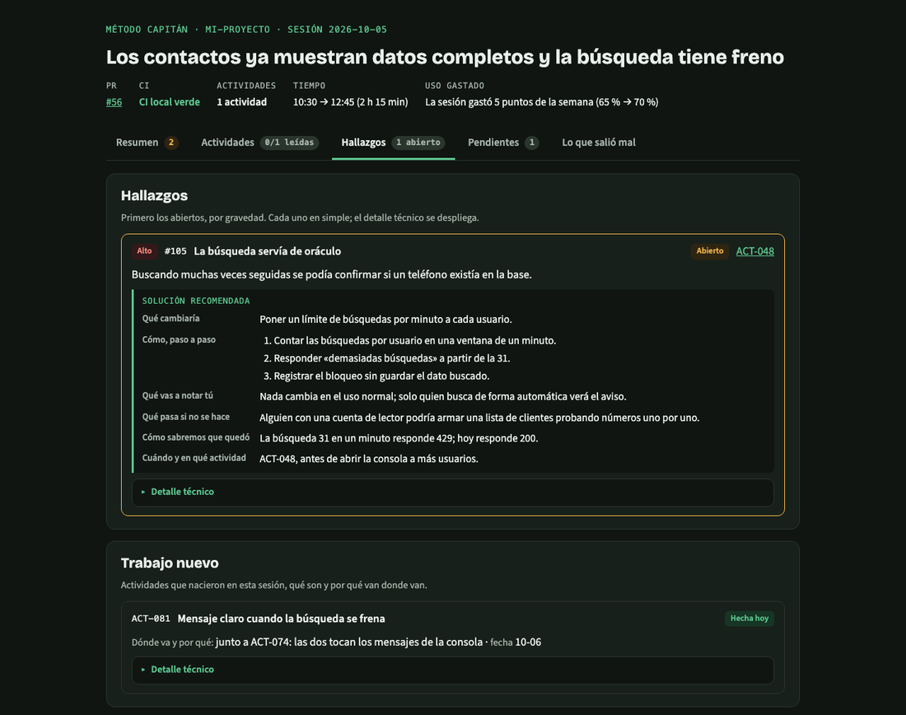

<p align="center">
  
</p>

<p align="center">
  
  
  
  
</p>

<p align="center">
  <a href="#capitanconfigurar">/capitan:configurar</a> ·
  <a href="#capitantrabajar">/capitan:trabajar</a> ·
  <a href="#los-agentes-de-cada-actividad">Los agentes</a> ·
  <a href="#cómo-reporta-cambios-y-hallazgos">Cambios y hallazgos</a> ·
  <a href="#entre-una-actividad-y-la-siguiente">Entre actividades</a> ·
  <a href="#el-reporte-final-de-la-sesión">Reporte final</a> ·
  <a href="#los-candados">Candados</a> ·
  <a href="#instalar">Instalar</a>
</p>

---

**Capitán** es un plugin de Claude Code que avanza el plan de un proyecto
**solo**, una actividad tras otra, con las mismas revisiones que haría un buen
equipo: un agente critica el plan, otro diseña las pruebas sin ver el código,
otro revisa la seguridad, y nada se integra sin evidencia. Todo queda escrito
en el repo, así que la siguiente conversación sabe exactamente dónde quedó.

Se usa con **dos comandos**:

| Comando | Cuándo | Qué hace |
|---|---|---|
| [`/capitan:configurar`](#capitanconfigurar) | Una vez por proyecto | Te hace preguntas y deja el repo listo: tracker, plan, pruebas, reglas y la memoria del proyecto |
| [`/capitan:trabajar`](#capitantrabajar) | Cada vez que quieras avanzar | Toma la siguiente actividad, la termina con evidencia, la documenta y sigue con otra hasta que algo lo detenga |

> [!NOTE]
> Los candados del plugin **solo se encienden en repos con `.claude/capitan.md`**,
> el archivo que crea `/capitan:configurar`. En los demás proyectos no hace nada.

<details>
<summary><b>Las palabras que vas a ver</b></summary>

| | |
|---|---|
| **Tracker** | La herramienta donde viven las tareas del proyecto, como Jira, Linear, Trello o GitHub Projects. Si el proyecto no tiene una, Capitán usa su propio **tablero local**, dentro del repo. |
| **MCP** | La forma en que Claude se conecta a otras herramientas, como tu tracker. Al configurar, Capitán busca los conectores que tienes, arma con el tuyo una tabla de qué herramienta hace cada cosa (ver, crear, mover, comentar) y la guarda. Hasta hoy se ha probado con un solo tracker de ese tipo y con el tablero local. |
| **Actividad** | Una tarjeta del tracker: una tarea con sus criterios de aceptación. Capitán atiende una a la vez, cada una en su propia rama. |
| **Skill** | Una guía de trabajo escrita que Claude sigue. Funciona mientras Claude se acuerde de seguirla. |
| **Candado (hook)** | Un programa pequeño que Claude Code corre solo, en momentos fijos, y que puede detener una acción. No depende de la memoria de nadie. |
| **Agente** | Otra instancia de Claude a la que se le encarga una parte: criticar, probar o revisar la seguridad. No vio cómo se hizo lo demás, y por eso su opinión vale. |

</details>

---

## `/capitan:configurar`

Deja el repo listo para trabajar. **Pregunta en cada decisión y no supone
nada**: lo que encuentra solo te lo confirma, y lo que no sabes queda como
`(pendiente)`, nunca inventado.

<p align="center"></p>

### Lo que te pregunta

| Paso | Qué revisa o te pregunta |
|---|---|
| **0 · ¿Ya hay configuración?** | Si el repo ya tiene `.claude/capitan.md`, te enseña un resumen y pregunta si la **revisa** o la **rehace**. Si viene de la versión anterior del método, ofrece **migrarla**. |
| **1 · Herramientas** | Comprueba de verdad (no supone) las skills de `senior-engineer-es`, GitHub (`gh auth status`), que git esté limpio, Python 3, el medidor de uso y que los hooks no estén duplicados. Te da una tabla ✅/❌. Si falta algo que bloquea, se detiene ahí. |
| **2 · ¿Con qué tracker?** | **Busca los conectores MCP que tienes** y te ofrece los que parecen de seguimiento, o escribes tú el tuyo. Con el que elijas arma la **tabla de equivalencias** (qué herramienta ve, crea, mueve, comenta y bloquea), la prueba solo leyendo, te la enseña, busca el proyecto y guarda su clave. Si no tienes ninguno, o prefieres no usarlo, crea el **tablero local** dentro del repo y te pregunta el prefijo de las ramas. |
| **3 · ¿Dónde está el plan?** | Busca `PLAN.md`, `ROADMAP.md`, `docs/plan*`… Cuenta como plan: épicas con alcance y orden. Si no hay, **no lo improvisa**: te manda a aterrizar la idea o a planear primero. |
| **4 · Lo que el plan necesita saber** | Lo busca en el repo y te lo confirma en bloque: quién es el **dueño** y cómo se le avisa, el registro de defectos, las reglas del repo, el **CI local en un comando**, la rama principal, el ambiente de verificación, cómo se levanta y apaga el entorno local, el **canal de prueba** permitido (tu teléfono o correo, o «no hay envíos»), el alcance vigente y las **reglas que no se negocian**. |
| **5 · Escribir la configuración** | **Te lo enseña antes de escribirlo.** Crea `.claude/capitan.md` y `docs/capitan/` con el relevo, las decisiones y los aprendizajes. No hace commit: eso lo decides tú. |
| **6 · Conciliar plan y tracker** | Compara: actividades que el plan no menciona, pendientes del plan sin actividad, vencidas, pausadas que siguen abiertas. **Propone** los cambios y no escribe nada en el tracker sin tu OK. |
| **7 · Cierre** | Te dice si quedó listo, qué falta y quién lo resuelve. |

<details>
<summary><b>Así se ve el cierre</b></summary>

```
Listo para /capitan:trabajar: sí
Tracker: local (docs/capitan/tablero.html)
Config: .claude/capitan.md (sin commit) · Memoria: docs/capitan/
Herramientas: ✅ skills · ✅ gh · ✅ git limpio · ✅ Python · ❌ medidor (opcional)
Falta: instalar el medidor de uso — tú, con /capitan:configurar §El medidor
Siguiente paso: /capitan:trabajar
```

</details>

---

## `/capitan:trabajar`

```
/capitan:trabajar                    # hasta que algo lo detenga
/capitan:trabajar hasta las 18:00    # con hora de corte
/capitan:trabajar 2 actividades      # con número de actividades
/capitan:trabajar solo ACT-020       # una sola
```

Una **sesión** es una serie de actividades. Cada una vive en su propia rama y,
al cerrarse, se junta en la **rama de la sesión**. Al final sale **un solo
PR** con todo, y el merge a la rama principal lo haces tú.

<p align="center"></p>

### Al arrancar

1. Recibe el **relevo** (`estado.md` y `decisiones.md`) sin que le cuentes nada.
2. Carga las skills de `senior-engineer-es`; sin ellas, las puertas serían de
   palabra y se detiene.
3. Lee el **uso de la cuenta** y la hora.
4. Revisa si ya hiciste merge del PR de la sesión anterior y mueve las tarjetas.
5. **Lee lo que contestaste en el reporte anterior**, antes de elegir: lo que
   marcaste como «Falló» se vuelve una actividad nueva.
6. Parte de la rama principal al día y con el árbol limpio.

### Cómo elige la actividad

La primera, en el orden del plan, que no esté bloqueada, que tenga sus
dependencias en Listo y que **quepa con su velocidad real**, medida en las
actividades que ya cerró, no con la estimación del tracker.

### Cómo atiende cada actividad

16 pasos en cuatro tramos. Cada tramo termina en una **puerta**: si no se
cumple, no se avanza.

<p align="center"></p>

<details>
<summary><b>Los 16 pasos, uno por uno</b></summary>

| # | Paso | Cómo | Puerta |
|---|---|---|---|
| 1 | **Rama propia** | Una actividad = una rama, desde la principal al día | Nada de PRs apilados |
| 2 | En curso | La tarjeta se mueve solo a la columna de al lado | — |
| 3 | **Plan** | Problema, archivos, decisiones con alternativas, riesgos, orden y cómo sabrá que quedó | Sin plan escrito no hay código |
| 4 | **Crítica** y **seguridad del plan** | Dos agentes en paralelo | Cada punto se corrige o se justifica por escrito, antes del código |
| 5 | **Plan de pruebas** | Un agente que solo conoce los criterios | — |
| 6 | **Si es bug, reproducirlo** | Un test que falla hoy, con la salida pegada | Sin reproducción no hay arreglo |
| 7 | **Implementar** | Con las convenciones del repo y una lista de desvíos respecto al plan | Reglas del repo intactas |
| 8 | **UI** | Medida en el navegador: emergentes abiertos, foco, accesibilidad | — |
| 9 | **Ajustar las pruebas** | Si hubo desvíos, el agente de pruebas los recibe | — |
| 10 | **Ejecutar las pruebas** | Tests y recorridos E2E con captura de cada paso, claro/oscuro y dos anchos | Verde con el cambio **y rojo sin él** |
| 11 | **Seguridad del diff** | En **toda** actividad | Cada hallazgo se cierra o se justifica |
| 12 | **Verificador** | CI local y puerta visual, con evidencia ejecutada | Todo verde o no se sube |
| 13 | **Entregar** | Commits con la clave, merge `--no-ff` a la rama de sesión | Nunca a la principal, nunca squash |
| 14 | **Documentar en el tracker** | Subtareas, comentario de cierre, a Revisión de código | — |
| 15 | **Hallazgos** | Al registro de defectos, con la solución recomendada completa | — |
| 16 | **Relevo** | Reescribe `estado.md` y anota todo para el reporte | Al día **antes** de tomar la siguiente |

Una actividad chica (solo textos o estilos) puede saltarse la crítica, pero
nunca las pruebas ni la seguridad del diff.

</details>

---

## Los agentes de cada actividad

Claude, en la conversación principal, es el **orquestador**: planea,
construye, integra y documenta. Las revisiones se las encarga a **agentes
frescos**, cada uno con un solo trabajo.

<p align="center"></p>

### Ojos frescos: por qué a cada agente se le oculta algo a propósito

Quien escribió el código ya está convencido de que funciona. Si el revisor lee
el razonamiento del autor, termina viendo lo mismo que él y pasando por alto
los mismos huecos. Por eso cada agente recibe **exactamente lo que necesita
para su trabajo, y nada que lo contagie**. No es una limitación: es lo que
hace que su revisión valga. Abre cada uno para ver qué recibe y por qué.

<details>
<summary><b>🔎 Crítico</b> · Opus · paso 4, antes de escribir código</summary>

**Recibe:** la actividad completa, su épica y especificaciones, las reglas del
repo, el código que va a tocar, los hallazgos relacionados y el plan.

**Se le guarda a propósito:** la defensa del plan, es decir, por qué Claude
cree que está bien.

**Por qué ayuda:** juzga el plan por lo que dice, no por lo convincente que
suena. Cada punto que levanta se corrige en el plan o se justifica por escrito
**antes** de escribir una línea, cuando cambiarlo cuesta casi nada.
</details>

<details>
<summary><b>🛡️ Seguridad del plan</b> · Opus · paso 4, si toca accesos, datos personales, secretos o algo externo</summary>

**Recibe:** lo mismo que el crítico, y corre en paralelo con él.

**Por qué ayuda:** encuentra el riesgo cuando todavía es un párrafo en el plan.
Arreglar un diseño inseguro en papel cuesta minutos; en código ya integrado
cuesta una actividad nueva.
</details>

<details>
<summary><b>🧪 Planeador de pruebas</b> · Opus · paso 5, antes de escribir código</summary>

**Recibe:** **solo** los criterios de aceptación tal como están escritos, y
los defectos relacionados.

**Se le guarda a propósito:** el plan y el código.

**Por qué ayuda:** diseña las pruebas para **lo que se pidió**, no para lo que
se construyó. Si el código tiene un hueco, sus pruebas lo encuentran en vez de
heredarlo. Empieza por los casos adversariales y dice qué debe fallar hoy.
</details>

<details>
<summary><b>🔁 Ajuste de pruebas</b> · Opus · paso 9, solo si hubo desvíos</summary>

**Recibe:** el plan de pruebas original, los criterios y la **lista de
desvíos** que llevó Claude al implementar.

**Se le guarda a propósito:** el código.

**Por qué ayuda:** sabe **qué** cambió respecto al plan, pero no **cómo** se
hizo. Así ajusta las pruebas a la nueva realidad sin dejar de medir lo que se
pidió.
</details>

<details>
<summary><b>▶️ Probador</b> · Sonnet · paso 10</summary>

**Recibe:** el plan de pruebas y el diff, y corre los tests de código y los
**recorridos E2E** en el entorno local, con un usuario de prueba (nunca
credenciales reales).

**Su regla:** cada prueba se ve **verde con el cambio y roja contra el código
anterior**; si pasa en los dos casos, no prueba nada. Captura cada paso, en
claro y oscuro y en dos anchos, y revisa la consola. Le está prohibido cambiar
un resultado esperado para que una prueba pase.
</details>

<details>
<summary><b>🛡️ Seguridad del diff</b> · Opus · paso 11, en toda actividad</summary>

**Recibe:** el diff completo.

**Por qué ayuda:** lee solo el cambio, línea por línea, sin la historia de
cómo se llegó a él. Corre en **toda** actividad, chica o grande, y cada
hallazgo se cierra o se justifica por escrito.
</details>

> [!IMPORTANT]
> **El reporte de un agente es una hipótesis.** Antes de un commit, el
> orquestador comprueba en disco todo lo que va a quedar escrito en un commit,
> un doc o un comentario.

<details>
<summary><b>Las reglas base de todo encargo, y el error que hizo nacer cada una</b></summary>

Todo encargo empieza con [`plantillas/brief-agente.md`](plantillas/brief-agente.md)
pegado tal cual, y un candado bloquea el encargo si no lo trae.

| Regla | Por qué existe |
|---|---|
| **Git prohibido** (solo lectura) | Un probador aplicó cambios viejos de otra sesión y dejó el repo en conflicto |
| **Quien escribe pruebas también compila** | Unas pruebas que no compilaban rompieron el build de toda la rama de sesión |
| **Nada corriendo al reportar** | Procesos vivos en segundo plano ensucian la siguiente actividad |
| **No afirmar lo que no comprobó** | Lo que no corrió se escribe como «no verificado» |
| **Prohibido cambiar un resultado esperado** | Si falla con el cambio, es un defecto y se reporta |
| **No tocar ambientes compartidos** | Ni contenedores ajenos, ni el tracker, ni GitHub, salvo que el encargo lo pida |

</details>

---

## Cómo reporta cambios y hallazgos

Cada actividad deja rastro en cuatro lugares, en el momento, no al final:

| Dónde | Qué queda |
|---|---|
| **Los commits** | Cada uno cita la clave de la actividad, y el merge a la rama de sesión dice `Merge <clave> …` |
| **La tarjeta del tracker** | Subtareas marcadas, el **comentario de cierre** y la tarjeta en Revisión de código |
| **El registro de defectos** | Cada hallazgo con qué pasa, dónde (`archivo:línea`), evidencia, el test que lo reproduce y la **solución recomendada completa** |
| **`decisiones.md`** | Lo que decidiste durante la actividad, con tus palabras, fecha y porqué |

<details>
<summary><b>El comentario de cierre de cada tarjeta</b></summary>

```
Qué se hizo: <una o dos líneas>
Rama / PR: <rama> · merge en <rama de sesión> · <PR de sesión>
Pruebas: <tests nuevos y qué cubre cada uno> — se vieron rojos contra la principal: <cómo>
Resultado: <salida resumida · CI local verde>
Pantalla: <capturas y juicio, o «no aplica»>
Seguridad: <veredicto>
Crítica: <hallazgos del crítico y qué se hizo con cada uno>
NO se probó: <lo honesto>
Velocidad: <inicio → cierre> · uso gastado · estimado vs real
Para el dueño: <merge · recorrido · decisión>
```

</details>

### La solución recomendada, siempre completa

Un hallazgo abierto no se queda en una línea técnica. Lleva seis partes,
escritas en simple:

| Parte | Qué contesta |
|---|---|
| **Qué cambiaría** | El arreglo en una o dos frases, sin jerga |
| **Cómo, paso a paso** | Los cambios concretos, en orden |
| **Qué vas a notar tú** | Lo que se verá distinto |
| **Qué pasa si no se hace** | El daño real y a quién, con un ejemplo |
| **Cómo sabremos que quedó** | La prueba que hoy falla y mañana pasa |
| **Cuándo y en qué actividad** | La clave y por qué en ese momento |

### Cuando aparece trabajo nuevo

Si descubre trabajo, o tú agregas alcance, **no lo manda al final de la
fila**: busca la actividad abierta que toca lo mismo y la acomoda **antes,
junto o después** de ella, con fecha calculada con su velocidad real. Te avisa
así: *«agregué ACT-031, junto a ACT-028, del 21 al 23, porque…»*. Las fechas
que ya existían **nunca se mueven**: si la nueva aprieta a otra, te avisa y tú
decides.

---

## Entre una actividad y la siguiente

Antes de tomar la siguiente, siempre:

1. **Reescribe el relevo** (`estado.md`): dónde quedó cada actividad, qué
   sigue, qué espera una decisión tuya y qué trampas hay abiertas. Si la
   conversación muere a media sesión, el relevo ya está.
2. **Mide con el reloj, no de memoria**: hora y uso gastado al empezar y al
   cerrar cada actividad. Con eso calcula su velocidad real.
3. **Revisa el uso de la cuenta**: si la ventana de 5 horas o la semanal llega
   al **85 %**, no empieza otra. Busca un punto limpio y se detiene.
4. **Elige la siguiente** con la misma regla de arriba.

| Si pasa esto… | …hace esto |
|---|---|
| Necesita una decisión tuya, un recorrido tuyo, o una fecha no va a llegar | **Te avisa con una notificación y sigue** con la siguiente actividad no bloqueada |
| Se acabó el uso, el presupuesto o no queda actividad sin bloqueo | **Se detiene del todo**, en un punto limpio, y arma el reporte |
| Las skills no cargan, falta la config o hay cambios ajenos que no entiende | **Se detiene** y te dice por qué |

---

## El reporte final de la sesión

Al detenerse, siempre entrega tres piezas y un PR:

<table>
<tr>
<td width="33%" valign="top">

**📄 El reporte en el repo**

`docs/capitan/sesiones/AAAA-MM-DD.md`, dentro del PR. Resumen arriba y, por
actividad, en simple **y** en técnico: qué se hizo, hallazgos, trabajo nuevo,
tiempo y uso, pruebas y qué no se probó. Al final, **«Lo que salió mal»**.

</td>
<td width="33%" valign="top">

**🖥️ Una página que contestas**

Sale de una plantilla única, igual en todos los proyectos. Pestañas: Resumen ·
Actividades · Hallazgos · Pendientes · Lo que salió mal. **«Necesito de ti»
se contesta ahí mismo.**

</td>
<td width="33%" valign="top">

**🧭 La memoria al día**

`estado.md` reescrito para la siguiente conversación, y `aprendizajes.md` con
cada lección: qué pasó y qué regla nace de eso.

</td>
</tr>
</table>

### Así se ve la página

<sub>Un ejemplo con datos ficticios, generado con <code>scripts/reporte.py --ejemplo</code>.</sub>

<p align="center"></p>

<table>
<tr>
<td width="50%" valign="top"><b>Una actividad:</b> en simple, lo técnico plegado, lo que te toca a ti y las fichas de prueba, con cómo se vio contra el código anterior.<br><br></td>
<td width="50%" valign="top"><b>Los hallazgos:</b> los abiertos primero, cada uno con su solución recomendada completa a la vista, y el trabajo nuevo con dónde va y por qué.<br><br></td>
</tr>
</table>

### Lo que encuentras en la página

- **«Necesito de ti»**: cada punto explica por qué lo pregunta y qué haría
  Claude, y se contesta con botones: Sí / No, opciones propias, «Ya lo hice»,
  «Tengo dudas» y un comentario. Cada propuesta dice si aplica **solo a este
  proyecto** o **a Capitán en general**.
- **Una tarjeta por actividad**, en el orden en que se atendió, con «Marcar
  como leída».
- **Fichas de prueba**: qué se hizo, esperado, real, Pasó / Falló y cómo se
  vio contra el código anterior. Las capturas llevan un juicio escrito, nunca
  «se ve bien».
- **Pendientes para ti**: solo lo que Claude no puede hacer (tu login, que algo
  llegue de verdad a tu teléfono, tu criterio), con pasos en simple, Pasó /
  Falló, comentario y evidencia en imagen.

Lo que contestas ahí, Capitán lo lee **al arrancar la sesión siguiente**,
antes de elegir actividad.

> [!TIP]
> El reporte **no se publica** si `scripts/revisar_reporte.py` encuentra que le
> falta algo: pruebas de una actividad, capturas, la solución completa de un
> hallazgo o el relevo actualizado.

<details>
<summary><b>El resumen que deja en el chat</b></summary>

```
Terminé: ACT-027 — Filtro por fecha · PR de sesión: <url>
Agregué: ACT-031 — Validar rango vacío · junto a ACT-028 · 21→23 · por qué ahí
Quedó a medias: ACT-029, rama x, falta el E2E
Uso gastado: 5 h +32 % · semana +6 % (10:05 → 13:40)
Velocidad: ACT-027 estimada 1 d, real 2 h 10 min
Fechas en riesgo: ACT-030 — depende de una respuesta tuya
Reporte: <enlace de la página> · docs/capitan/sesiones/AAAA-MM-DD.md
Necesito de ti: merge del PR · recorrido de ACT-027 · decisión en ACT-030
```

</details>

---

## Los candados

Una regla escrita en una guía funciona mientras Claude se acuerde de ella. Un
**candado** (hook) es un programa que Claude Code corre solo, en un momento
fijo, y que puede **detener** una acción. Es como el torniquete del metro: no
le pide a nadie que se acuerde de pagar, simplemente no gira sin boleto.

| Candado | Cuándo corre | Qué hace | Por qué nació |
|---|---|---|---|
| **Relevo al abrir** | Al abrir, retomar, después de `/clear` y al compactar | Le entrega a Claude el estado y las decisiones | Una conversación se compactó y lo que Claude sabía dependía de su propio resumen |
| **Aviso de decisiones** | En cada mensaje tuyo | Le recuerda escribir la decisión si el mensaje trae una | Cuesta unas palabras por mensaje |
| **Brief de cada agente** | Al encargar a un agente | 🛑 Bloquea el encargo si no trae las reglas base | Un agente probó pero no compiló, y rompió el trabajo de todos |
| **Agentes sin git** | En cada comando de un agente | 🛑 Bloquea commits, cambios de rama, merges, stash… | Un agente aplicó cambios viejos y dejó el repo en conflicto |
| **Juez de decisiones** | Antes de `git merge` y `gh pr create` | 🛑 Otro modelo (Sonnet) compara lo que dijiste con `decisiones.md` y bloquea si falta algo, citando tus palabras | Es el único que gasta uso, por eso corre solo en esos dos momentos |
| **Push con pruebas** | `git push` de una rama con PR abierto | 🛑 Exige el CI local en verde sobre ese mismo commit | Un PR corrió las pruebas de GitHub tres veces en una hora, y cada corrida se cobra |

Si un candado no puede correr (por ejemplo, sin internet), **avisa y deja
pasar** en vez de bloquear.

---

## La memoria del proyecto

Una conversación se llena y se acaba; el proyecto sigue. Por eso todo lo que
importa vive **en el repo**, viaja en el PR y se revisa como cualquier cambio.

```
.claude/capitan.md              la configuración: tracker, dueño, pruebas, reglas propias
docs/capitan/
├── estado.md                   el relevo: dónde quedó, qué sigue, qué espera una decisión
├── decisiones.md               lo que decidió el dueño, con fecha y porqué (solo lo vigente)
├── decisiones-historial.md     las decisiones reemplazadas
├── aprendizajes.md             lo que salió mal y la regla que nació
├── sesiones/AAAA-MM-DD.md      el reporte de cada sesión
└── tablero.json / .html        el tablero local, si no hay otro tracker
```

### El tracker

Capitán usa siempre las mismas operaciones (ver, crear, mover, comentar,
bloquear) sobre un **tracker externo conectado por MCP** o sobre el **tablero
local** (`scripts/tablero.py`: un JSON en git y una página con vistas de
tablero, lista y sesiones). En los dos, una tarjeta solo avanza a la columna de
al lado:

**Backlog → Por hacer → En curso → Revisión de código → Pruebas funcionales → Por desplegar → Listo**

### Lo que sigue siendo tuyo

| | |
|---|---|
| **Decidir** | Reglas de negocio, alcance y prioridades. Claude pide la decisión en una línea y sigue con lo demás. |
| **Aprobar** | Nada entra a la rama principal sin que una persona haga el merge. |
| **Las fechas** | Claude pone fecha a lo nuevo, pero nunca mueve las que ya existían. |
| **Validar** | Que se entienda, que se vea bien, que llegue de verdad. Va en el reporte como pendiente. |

---

## Instalar

Requiere **Python 3** (`python3`, `py -3` o `python`), **GitHub CLI** (`gh`)
autenticado, y el plugin **`senior-engineer-es`**, cuyas skills son las puertas
de cada paso. Se instala solo con Capitán si antes agregas su marketplace:

```bash
claude plugin marketplace add kitoep/sensei
claude plugin marketplace add kitoep/capitan
claude plugin install capitan@capitan
```

Cierra Claude por completo, vuelve a abrirlo y, dentro del repo, corre
`/capitan:configurar`.

<details>
<summary><b>Preguntas frecuentes</b></summary>

**¿Los candados gastan uso?** Casi todos no: corren en tu computadora. El único
que consume es el juez de decisiones, y por eso corre solo al hacer merge y al
abrir el PR.

**¿Afecta mis otros proyectos?** No. Solo se encienden donde existe
`.claude/capitan.md`.

**¿Necesito un tracker externo?** No. Sin tracker, Capitán usa el tablero local.

**Lo instalé y no pasa nada.** Cierra Claude por completo; `/clear` no carga
plugins nuevos. Escribe `/capitan`: deben aparecer `trabajar` y `configurar`.

**¿Qué pasa si un candado se equivoca?** Siempre dice por qué bloquea. Si el
juez marca algo que no era una decisión, se anota como falso positivo en
`aprendizajes.md` y se sigue.

**¿Funciona con otros modelos?** El plugin es de Claude Code. La memoria en
`docs/capitan/` sí sirve con cualquier herramienta: son archivos de texto.

</details>

<details>
<summary><b>Estructura del repo</b></summary>

```
.claude-plugin/        manifiesto del plugin y del marketplace
skills/configurar/     /capitan:configurar
skills/trabajar/       /capitan:trabajar — el método completo
hooks/hooks.json       qué candado corre en qué momento
scripts/               candados, tablero, medidor, reporte y sus revisores
plantillas/            el brief de agentes y la página del reporte
docs/assets/           el banner y los diagramas de este README
```

</details>
